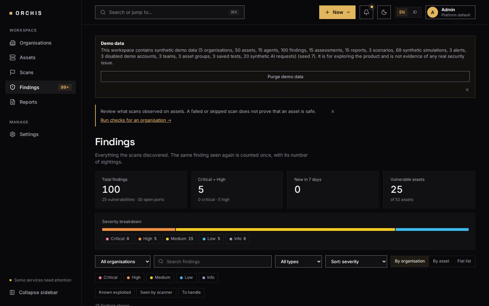

# ORCHIS

**Validasi keamanan berkelanjutan untuk Red Team dan Blue Team.** Self-hosted,
dengan backend Go, frontend React, dan laporan PDF/JSON.

ORCHIS menjadwalkan pengujian keamanan terotorisasi terhadap aset Anda dan
memantau endpoint dari dalam, lalu mengumpulkan semuanya dalam satu antrean: apa
yang ditemukan, seberapa parah, dan apakah perbaikannya benar-benar berhasil.



<sub>Tangkapan layar memakai data demo sintetis.</sub>

## Apa yang dikerjakan

| Sisi | Yang dijalankan | Yang Anda dapat |
|---|---|---|
| **Red** (orchis-redteam-agent) | Nmap dan Nuclei sebagai persiapan, lalu pengujian web melalui worker terisolasi | Temuan tervalidasi beserta bukti dan saran perbaikan |
| **Blue** (DefenseBot) | Agent ringan di endpoint mengumpulkan data osquery yang disetujui tentang software, akun, dan jaringan | Pencocokan CVE untuk software terpasang, serta temuan hardening |
| **Monitoring** | Agent yang sama melapor sekitar sekali per menit | Deteksi port listening baru, akun lokal baru, koneksi keluar mencurigakan, dan agent yang diutak-atik |

Alur utamanya:

**Organisasi → Aset dan agent → Pindai → Temuan → Laporan → Perbaikan dan uji ulang**

Full assessment memilih engine per aset: URL yang disetujui menjalankan Red Team
agent, agent endpoint menjalankan DefenseBot, dan aset yang punya keduanya
menjalankan keduanya.

Hal yang perlu diketahui sebelum mengandalkan sebuah hasil:

- Pengujian memerlukan otorisasi eksplisit per aset dan jendela pindai yang berlaku.
- Pindai yang gagal atau parsial dicatat sebagai keterbatasan. Hasil kosong tidak
  membuktikan aset aman.
- Software yang tidak bisa dipetakan ke data kerentanan tetap dihitung dan
  ditampilkan sebagai "belum terpetakan". Software itu tidak dilewati diam-diam.
- Deteksi yang tidak teramati lagi otomatis ditandai kedaluwarsa (stale). Deteksi
  tidak pernah dihapus.

## Mulai cepat (pengembangan)

Siapkan Go (lihat `go.mod`), Node.js (lihat `.nvmrc`), Docker dengan Compose v2,
dan Python 3.12+.

```bash
npm --prefix web ci
make dev-up                     # PostgreSQL di 127.0.0.1:15432
make build                      # frontend + biner server
./bin/server migrate
ORCHIS_WEB_DIR=$PWD/web/dist ORCHIS_ADMIN_EMAIL=admin@orchis.local ./bin/server serve
```

Bila `ORCHIS_ADMIN_PASSWORD` kosong, password admin pertama dibuat acak dan
dicetak sekali di log. Lihat [pengembangan dan tes](docs/DEVELOPMENT.md) untuk
scanner, agent endpoint, dan rangkaian tes lengkap.

## Deployment produksi

Produksi berjalan sebagai stack Docker Compose di Linux amd64 (PostgreSQL,
RabbitMQ, Elasticsearch, penyimpanan objek, dan Caddy untuk HTTPS). Secret dan
state disimpan di luar checkout.

```bash
make hackbot-check                 # validasi source engine dalam repo, tanpa Docker
sudo make prod-init                # sekali untuk state baru; secret di /var/lib/orchis
sudo python3 deploy/prod/ops.py env > .env
sudo make prod-build
sudo make prod-up
sudo make prod-probe
```

Source worker Red Team tersedia di `engines/hackbot-lite` dan
`engines/opencode-hackbot` dalam repo ini. Lihat
[panduan build worker](deploy/hackbot/README.md#build-and-configure).

Untuk instalasi yang sudah ada, pakai `ORCHIS_STATE` yang sama dan ikuti
[prosedur upgrade](docs/OPERASI.md); jangan menjalankan init ulang. Login
pertama ada di `initial-admin.json` dalam direktori state privat. HTTPS, rilis
agent, dan pengaturan installer dijelaskan di [deployment](docs/DEPLOY.md).
Jalankan `make help` untuk melihat semua perintah.

## Agent endpoint

Pasang agent dari **Assets → Agents** di konsol. Agent mendaftar dengan token
sekali pakai, hanya membuka koneksi keluar ke platform, dan menjalankan
pemeriksaan hanya-baca.

| Platform | Koleksi endpoint |
|---|---|
| Linux x86_64 | Didukung. Paket Debian dan Ubuntu dicocokkan ke CVE. |
| macOS x86_64 / arm64 | Didukung |
| Windows x86_64 / arm64 | Didukung |

Distribusi berbasis RPM belum dicocokkan ke kerentanan, dan cakupan aplikasi
terpasang berbeda per sistem operasi. Rinciannya ada di
[DefenseBot](docs/DEFENSEBOT.md).

## Struktur repo

| Lokasi | Isi |
|---|---|
| `cmd/` | Entry point: server, agent, injector, dan utilitas rilis |
| `internal/` | Domain, layanan, API, worker, dan tes Go |
| `web/` | Aplikasi React dan tes frontend |
| `migrations/` | Migrasi PostgreSQL, dijalankan sebelum server versi baru |
| `deploy/` | Dockerfile, konfigurasi pengembangan dan produksi, engine lock, CI |
| `e2e/` | Fixture, tes browser, dan pemeriksaan alur lengkap |
| `docs/` | Panduan produk, API, operasi, dan arsitektur |
| `docker-compose.yaml` | Stack produksi; pengaturan non-rahasia berasal dari `.env` |

Setiap komponen Node (`web/`, `e2e/`, `deploy/report/`) punya lockfile sendiri,
jadi jalankan npm dengan `--prefix`, bukan dari root repo.

## Dokumentasi

- [Indeks dokumentasi](docs/README.md)
- [Alur produk dan kesiapan aset](docs/FLOW.md), [peran pengguna](docs/ROLES.md), [panduan pengguna](docs/USER-GUIDE.md)
- [Audit terjadwal](docs/AUDIT-SCHEDULES.md)
- [API dan OpenAPI](docs/API.md), [skema laporan](docs/REPORT-SCHEMA.md)
- [Operasi, upgrade, backup dan restore](docs/OPERASI.md)
- [Arsitektur](docs/ARSITEKTUR.md), [kompatibilitas fitur historis](docs/FEATURE-COMPATIBILITY.md)
- [Changelog](CHANGELOG.md)

## Gunakan secara bertanggung jawab

Uji hanya sistem yang Anda miliki atau yang secara eksplisit boleh Anda uji.
ORCHIS menegakkan otorisasi per aset, tetapi tanggung jawab atas cakupan
pengujian tetap ada pada Anda.

## Lisensi

[Apache-2.0](LICENSE). Komponen pihak ketiga tercantum di [NOTICE](NOTICE).
