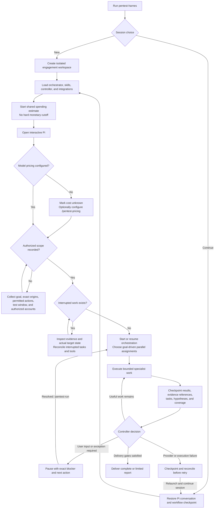
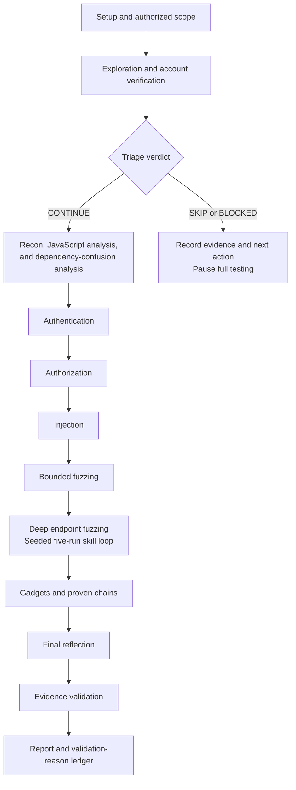
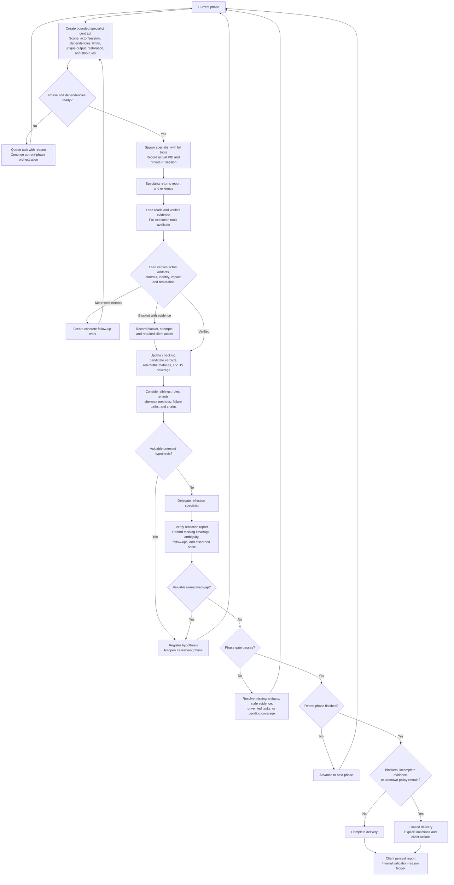

# Harness workflow

`pentest-harnes` launches interactive Pi with the orchestrator, all 21 bundled
skills, persistent engagement state, and the workflow controller. The diagrams
below describe session startup, phase ordering, and the mandatory verification,
reflection, and hypothesis loop.

## 1. Startup and sessions

Each session lives under `.pentest-harnes/sessions/<session-id>/`. Its Pi
conversation, workflow checkpoint, evidence, and previous spending ledgers persist
across launches. Selecting a saved session restores that engagement; a new session
gets a separate workspace.

Spending estimates reset on each launch, including when continuing an existing
session. The user chose no hard monetary cutoff; $15 is only a reporting
reference. Compression-internal model calls may not be fully counted. Unknown
prices stay marked unknown; `/pentest-pricing` supplies USD-per-million rates.

## 2. Enforced phase order

Every phase uses the loop below before advancement. The final reflection phase
adds engagement-wide reconciliation after gadgets; it does not replace reflection
after earlier phases. Recon requires separate recon, JavaScript-analysis, and
dependency-confusion specialist coverage.

New discoveries reopen the relevant gates:

| Discovery | Reopened work |
| --- | --- |
| New role | Exploration/account setup, followed by downstream coverage reconciliation. |
| New collected JS/map asset | Recon, source review, and downstream coverage reconciliation. |
| New pending authorization cell after authz completion | Authorization and downstream gates. |
| Valuable follow-up hypothesis | Its relevant phase, with an explicit reason for reopening. |

## 3. Verification, reflection, and hypothesis loop

There is **no fixed eight-hour runtime or arbitrary reflection iteration cap**.
Running engagements continue after ordinary agent turns while useful authorized
work remains and the provider is available; spending is estimated rather than capped.
Per-task deadlines still apply. Exceptions requiring user input pause execution.

### Completion rules

- **Returned is not verified.** The lead reads the actual specialist report and
  underlying evidence before accepting a task.
- **Planning is not execution.** Actual worker PIDs and process logs establish
  that a specialist ran. The lead cannot replace rejected/queued delegation with
  its own testing; its execution tools require bounded returned-task verification.
- **Offline is valid.** Local review/reflection uses empty targets and zero
  requests/rate. Independent offline review may run ahead of its phase label;
  future live work and unmet dependencies remain queued.
- **Blocked is not passed.** Checklist blockers retain their reason, attempts,
  evidence, and required client action. Pending items prevent completion.
- **Reflection must be fresh.** Every phase requires a verified delegated
  reflection task. Subsequent coverage changes invalidate earlier reflection.
- **Hypotheses need dispositions.** Relevant hypotheses must have a verdict or
  an explicit blocker; finding one vulnerability does not end the loop.
- **Evidence integrity is checked.** Actual files are hashed and rechecked at
  gates. The lead still judges their meaning, policy, and demonstrated impact.
- **Coverage claims remain honest.** Missing role/cell/asset coverage, unresolved
  candidates, and unknown policy limit delivery rather than establishing full
  coverage.
- **Delivery requires both files:** `<target>_PENTEST_REPORT.md` and
  `<target>_VALIDATION_REASON.md`. Client findings must be validated.

## 4. Controls and integrations

| Control | Behavior |
| --- | --- |
| Model spending | Shared estimate per launch, no hard monetary cutoff; context-proxy internal usage may be incomplete. |
| Managed traffic | Up to 50 requests/second aggregate, respecting stricter skill limits. |
| Specialist concurrency | Eight workers by default; configurable with `PENTEST_HARNES_MAX_AGENTS`. Batch independent assignments; serialize conflicting state and same-session mutations. |
| Recovery | Reconcile interrupted work and observed target state before continuing; never blindly repeat a possibly completed mutation. |
| Worker lifetime | Task deadlines and parent-liveness checks stop orphaned specialists. |
| Lead execution | Full tools, including bash and HTTP/MCP. Verification grants are optional replay contracts. |
| Specialist tool access | Specialists retain full tools; shell/browser requests and requests issued internally by MCP servers use the tools' own limits. Native MCP calls, including codemode-nested calls, pass through the harness scheduler. |

Browser work uses Interceptor; replay and named evidence use Burp/Caido. Gmail
verification uses `gog`, authenticator challenges use `totp-cli`, and SMS
verification uses Textbee. The launcher reuses existing Pi configuration and
imports OpenCode MCP definitions into the private native configuration at
`workspace/.pi/mcp.json`. Pi's built-in MCP support connects enabled servers in
the background; native tools are discovered through codemode or `tool_search`.
Configured services are verified for live connectivity and authentication during
their use.

The `interceptor`, `interceptor-browser`, and `interceptor-research` skills,
including their references and workflows, are bundled under `skills/`. Pi loads
the installed copies from the engagement workspace.

With `pi-subagents`, actual native child runs appear in `/subagents-fleet`.
Click/select a row in fullscreen mode to inspect live transcripts and tool
activity. The harness keeps admission, scope, phase, and verification ownership;
the package owns native worker execution and inspection. Pix Todo is a planning
view, separate from evidence-backed coverage, and billion-context manages long
conversation context without owning the workflow state.

Use `/pentest-agents`, `/pentest-status`, `/pentest-run`, and `/pentest-pause` inside Pi. Use
`pentest-harnes sessions`, `--session <id>`, and `--new` to manage saved sessions.

## Implementation references

- [Launcher and session selection](../internal/launcher/launcher.go)
- [OpenCode MCP conversion](../internal/launcher/config.go)
- [Pi tools, lifecycle hooks, and automatic continuation](../pi-runtime/extension.ts)
- [Actual specialist process runner and persisted PID/progress](../pi-runtime/specialists.mjs)
- [Workflow controller and phase gates](../pi-runtime/controller.mjs)
- [Shared spend reporting and request scheduler](../pi-runtime/budget.mjs)
- [Persistent orchestrator execution contract](../pi-runtime/ORCHESTRATOR.md)
- [Pentest entry skill](../skills/pentest/SKILL.md)
- [Universal checklist](../skills/pentest/references/checklist.md)
- [Reflection skill](../skills/pentest-reflection/SKILL.md)

[Back to README](../README.md)
